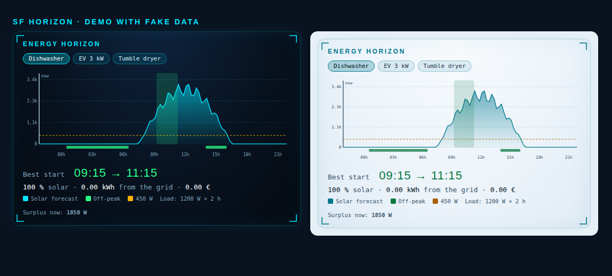

# SF Horizon

**"When should I start the dishwasher?"** A Lovelace card that puts the next 24 hours of **solar forecast**, your **off-peak tariff windows** and your **house baseline** on one chart — and tells you the best time to start a heavy appliance.

[](https://hacs.xyz)
[](https://khrom06.github.io/SF-Horizon/)
[](LICENSE)
[](https://my.home-assistant.io/redirect/hacs_repository/?owner=khrom06&repository=SF-Horizon&category=dashboard)

<p align="center"></p>

Same HUD look as [SF Cards](https://github.com/khrom06/SF-Cards): the cards sit side by side on one dashboard.

> **Why this exists.** The Energy dashboard shows what *happened*. The numbers you need to decide *when to run a load* (forecast, tariff windows, current consumption) already live in Home Assistant, but nothing puts them together. SF Horizon does the arithmetic in the browser and shows its reasoning on the chart.

## Install

1. HACS → ⋮ → *Custom repositories* → add `https://github.com/khrom06/SF-Horizon`, category **Dashboard**; install.
2. Reload the browser (HACS registers the resource for you).

You need a forecast sensor that exposes a `watts` attribute (a map of timestamp → watts), such as those of **Open-Meteo Solar Forecast** or **Forecast.Solar**. Sensors with a `wh_period_15m` attribute (Wh per 15 min) work too.

## Configuration

```yaml
type: custom:sf-horizon-card
forecast: sensor.energy_production_today            # today's forecast sensor (has a `watts` attribute)
forecast_tomorrow: sensor.energy_production_tomorrow  # optional, so the chart can reach past midnight
offpeak: ["00:56-06:56", "14:26-16:26"]             # off-peak windows, may cross midnight
peak_price: 0.22                                    # price per kWh, optional (enables the cost estimate)
offpeak_price: 0.16
currency: "€"
baseline_w: 450                                     # typical house consumption in W (default 500)
consumption: sensor.house_power                     # optional: use the live consumption as the baseline instead
surplus: sensor.solar_surplus                       # optional: shows the current surplus
loads:                                              # appliances to choose from; or just load_w / load_hours
  - { name: Dishwasher, power: 1200, hours: 2 }
  - { name: EV 3 kW,    power: 3000, hours: 3 }
hours: 24                                           # horizon, 6–48
theme: auto                                         # auto | dark | light
```

### How the best start is chosen

For every 15-minute start time in the horizon, the card simulates the run:

1. **Solar available** at each step = forecast − baseline (never below 0).
2. **Covered share** = what the available solar covers of the appliance's power.
3. Candidates are ranked by **solar coverage** (5 % steps), then by **grid cost** (using your two prices), then by exact coverage, then by the **earliest** start.

With no solar at all (winter nights) the ranking falls back to the cheapest tariff window. With no forecast sensor and no off-peak windows the card says so instead of guessing.

The green rectangle on the chart is the proposed run; the green strip at the bottom marks off-peak time; the dashed line is the baseline.

Languages: en, fr, es, de, nl, it, pt, pl, ru, zh, ar (right-to-left for Arabic), the same eleven as SF Cards. The card follows the Home Assistant language; set `language: xx` on a card to force one.

## Safe by design

* Read-only: it never calls a service or switches anything. Tapping a preset only changes what the card computes.
* It re-renders when a forecast changes, when a preset is chosen, and once a minute so that "now" moves. It does not redraw on unrelated state changes.
* Bad input is handled: invalid windows are dropped, non-numeric forecast values ignored, gaps longer than 3 h in the forecast count as "no sun", and a non-positive load is rejected with a clear message.

## Tests

```bash
./test/run.sh   # build check + 329 render checks in headless Chrome (window parsing, series merge, interpolation, slot search, card)
```

---

> **Made by Claude.** Designed and written by Claude (Anthropic's AI) working with its human partner. MIT licensed.
